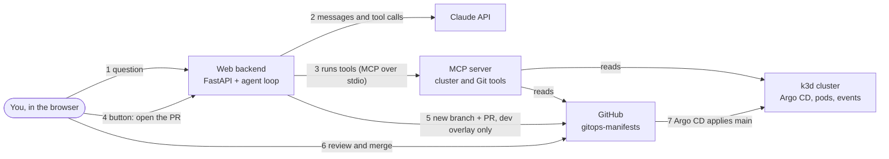

# oncall-agent

An on-call AI agent for a GitOps Kubernetes cluster. You ask it in a chat what is wrong. It
investigates with read-only tools (Argo CD, pods, events, Git history), explains the cause in
Spanish with the evidence it found, and proposes the fix as a pull request to the GitOps repo.
A person opens that pull request with a button and merges it on GitHub; the agent then follows
Argo CD until the environment is healthy again.

It runs on a laptop next to a local [k3d](https://k3d.io) cluster whose apps are deployed by
Argo CD from [gitops-manifests](https://github.com/JavierMolero12/gitops-manifests).

**Status:** phase 1 (fault 1: a bad image tag in dev) is built and tested. The end-to-end
rehearsal against the real cluster is tracked in [docs/demo-fase-1.md](docs/demo-fase-1.md).

## How it works



1. You ask, for example, *"¿Qué le pasa a sample-api en dev?"*.
2. The backend runs a hand-written tool-use loop with the official Anthropic SDK: Claude asks
   for a tool, the backend runs it and sends the result back, until Claude answers. A step limit
   (15 by default) caps the cost of one question.
3. The tools live in an MCP server built with the official MCP Python SDK. The backend starts it
   as a subprocess and talks to it over stdio. Each step appears live in the *Pasos del agente*
   panel (Server-Sent Events).
4. When Claude has found the cause, it calls `propose_fix`, which writes nothing: it checks the
   proposal and returns a diff. The page shows the diff and a button.
5. You press the button. The backend, not the model, calls `open_pull_request` with the proposal
   it stored: a new branch `oncall-agent/fix-<timestamp>`, one commit, one pull request.
6. You review and merge the pull request on GitHub.
7. Argo CD applies `main`. Meanwhile the chat follows the recovery: pull request merged, Argo CD
   synced at the merge commit, environment healthy.

### Tools

| Tool | What it does |
|---|---|
| `get_environment_status` | Health of an environment, as shown in the status panel |
| `get_argocd_app` | Argo CD `Application`: sync status, health, revision |
| `get_deployment` | Image, replicas and rollout progress |
| `list_pods` | Pods with their state and reason (for example `ImagePullBackOff`) |
| `get_pod_events` | Events of one pod |
| `list_recent_commits` | Recent commits that touched a path in gitops-manifests |
| `get_commit_diff` | The changes of one commit |
| `read_manifest` | A file from gitops-manifests |
| `propose_fix` | Checks a proposed file and returns the diff; writes nothing |
| `get_pull_request` | State of a pull request |
| `open_pull_request` | **The only write.** Never offered to the model (see below) |

## Security model

- **Read-only on the cluster.** The tools only get and list through the Kubernetes API; none
  creates, changes or deletes anything. Argo CD is read through its `Application` resources,
  without logging in to Argo CD. The agent never forces a sync either.
- **The model has no write tools.** The backend offers Claude only the tools marked read-only,
  and the loop refuses to run any tool name it did not offer.
- **One narrow write, behind a person.** `open_pull_request` runs when you press the button. It
  uses the stored proposal, not new text from the model. It only accepts files under
  `apps/overlays/dev/`, refuses if the file changed on `main` since the proposal, and works on a
  new branch. There is no tool to merge, approve or push to `main`.
- **Two human gates:** you press the button, and you merge the pull request.
- **Secrets** live in a local `.env` that Git ignores; `.env.example` shows the variables.
- **The web page has no login,** so the server only listens on `127.0.0.1`.

### Known limitations (v1)

- **The GitHub token can do more than the code does.** It is a fine-grained personal access
  token scoped to gitops-manifests with Contents and Pull requests read/write. It acts as its
  owner, who administers the repo, so the token itself could push to `main` or merge, and
  fine-grained tokens cannot be limited to some branches. What stops that today is that the
  agent's code has no such functions. In production the agent would get its own identity, a
  GitHub App installed only on the GitOps repo, and `main` would be protected by a ruleset
  (pull requests and an approving review required, no bypass for the app). Then even a
  compromised agent could only open pull requests.
- **The kubeconfig context is a cluster admin.** The code only reads, but the credentials allow
  more. Phase 3 replaces them with a read-only ServiceAccount and ClusterRole deployed through
  GitOps.

## Requirements

- Windows 10 or 11 (tested on Windows 10), Python 3.13 or newer, Git.
- Docker Desktop and the k3d cluster `gitops-demo` with Argo CD and the apps from
  gitops-manifests; `kubectl` with the context `k3d-gitops-demo`.
- A Claude API key from the [Anthropic Console](https://console.anthropic.com/).
- A fine-grained GitHub token. On GitHub: *Settings → Developer settings → Personal access
  tokens → Fine-grained tokens → Generate new token*. Repository access: *Only select
  repositories* → `gitops-manifests`. Permissions: *Contents* and *Pull requests*, both
  *Read and write* (*Metadata: read* is added automatically). Give it a short expiration.

## Install (Windows, PowerShell)

```powershell
git clone https://github.com/JavierMolero12/oncall-agent.git
cd oncall-agent
py -3.13 -m venv .venv
.venv\Scripts\python -m pip install -e ".[dev]"
copy .env.example .env
notepad .env   # fill in ANTHROPIC_API_KEY and GITHUB_TOKEN
```

The commands call `.venv\Scripts\python` directly, so the virtual environment never needs to be
activated. The model defaults to `claude-sonnet-5-5`; set `ONCALL_MODEL` in `.env` to change it.

## Prepare Argo CD (once per cluster)

Argo CD checks Git every few minutes by default. In the cloud a GitHub webhook would tell it
about each commit right away, but webhooks cannot reach a laptop, so the demo would wait minutes
twice: after the faulty commit and after the merge. This script sets the polling interval
(`timeout.reconciliation` in the `argocd-cm` ConfigMap) to 30 s and restarts the two Argo CD
components that read it:

```powershell
.venv\Scripts\python scripts\setup_argocd_polling.py
kubectl --context k3d-gitops-demo -n argocd get cm argocd-cm -o jsonpath="{.data.timeout\.reconciliation}"
```

The second command should print `30s`. `argocd-cm` is not managed from gitops-manifests, so run
the script again whenever you recreate the cluster. On a real cluster, polling this often costs
Git API calls and repo-server work for every app; a webhook is the better answer there.

## Run

```powershell
.venv\Scripts\python -m oncall_agent.web
```

Then open <http://127.0.0.1:8765>. The left side is the chat; the right side shows the live
state of each environment and the agent's steps.

The MCP server also works on its own, for example from Claude Code (run it from the repo folder,
because the server reads `.env` from the folder it starts in):

```powershell
claude mcp add oncall-agent -- .venv\Scripts\python -m oncall_agent.mcp_server
```

In such clients the model can see `open_pull_request` as well, so the client's own approval
prompt is the only gate. Leave `GITHUB_TOKEN` out of `.env` there and that tool refuses to run.

## Run the demo

The full script, with what to say at each step, is in [docs/demo-fase-1.md](docs/demo-fase-1.md).
In short:

1. Check that the status panel shows dev as *Sano*.
2. Break dev the way a bad human commit would:
   `.venv\Scripts\python scripts\demo_faults.py break image`. It commits `newTag: "v9.9.9"`, a
   tag that does not exist, straight to `main` of gitops-manifests.
3. Within about a minute the panel shows dev as *Actualización atascada*: the new pod cannot pull
   the image while the old one keeps serving.
4. Ask *"¿Qué le pasa a sample-api en dev?"*. The agent should name `v9.9.9`, the commit that
   introduced it and the good tag that prod runs, and propose the fix.
5. Press *Abrir Pull Request con el arreglo*, then review and merge the pull request on GitHub.
   The chat follows the recovery and the panel goes back to *Sano*.

If anything goes wrong, `.venv\Scripts\python scripts\demo_faults.py restore` sets dev back to
the tag that prod is running, again with a commit to `main`.

> **Do not push to `sample-api` during the demo.** Its CI rewrites `newTag` in
> `apps/overlays/dev` with an automatic commit, which would replace both the broken tag and the
> fix.

## Development

```powershell
.venv\Scripts\python -m pytest -q
.venv\Scripts\python -m ruff check .
```

The tests need neither the cluster, GitHub nor the Claude API: GitHub is an in-memory fake
behind `httpx.MockTransport`, and the model is a scripted fake.

```
src/oncall_agent/
  config.py         settings from .env
  kube.py           Kubernetes clients
  status.py         environment health for the status panel
  tools/            the tools: cluster.py (Kubernetes, Argo CD), gitops.py (Git)
  github.py         a small client for the GitHub REST API
  mcp_server.py     the MCP server with the tools
  toolbox.py        the MCP client the backend uses
  agent.py          the tool-use loop and its system prompt
  recovery.py       follows a merged fix: pull request, Argo CD, healthy
  web/              FastAPI app and the page (HTML, CSS, JavaScript, no build step)
scripts/            demo_faults.py, setup_argocd_polling.py
docs/               design, plan, demo script and a study guide (in Spanish)
```

## Roadmap

- **Phase 2:** two more faults, with the tools they need (container logs, container state,
  resources and metrics) and their break and restore scripts.
- **Phase 3:** a read-only ServiceAccount and ClusterRole deployed through GitOps, a recording of
  the demo in this README, and interview notes.
