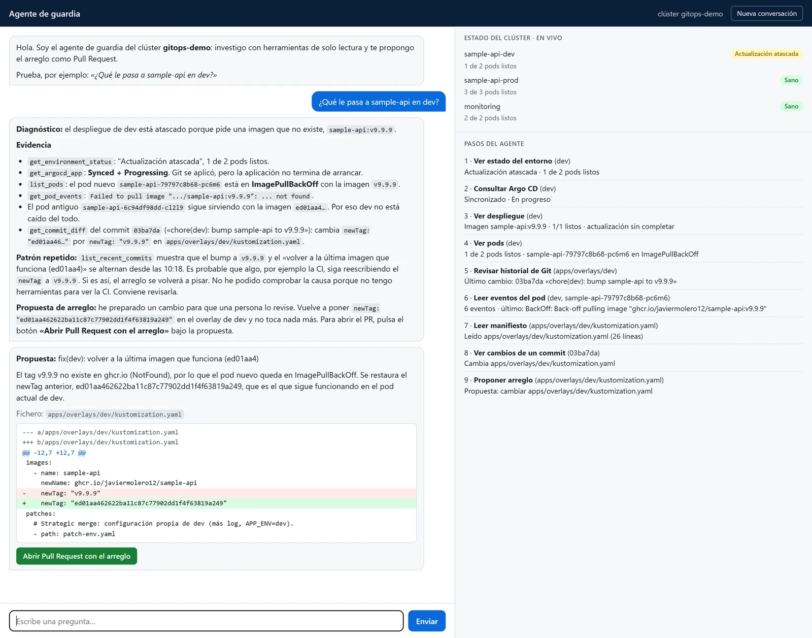
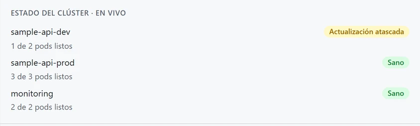
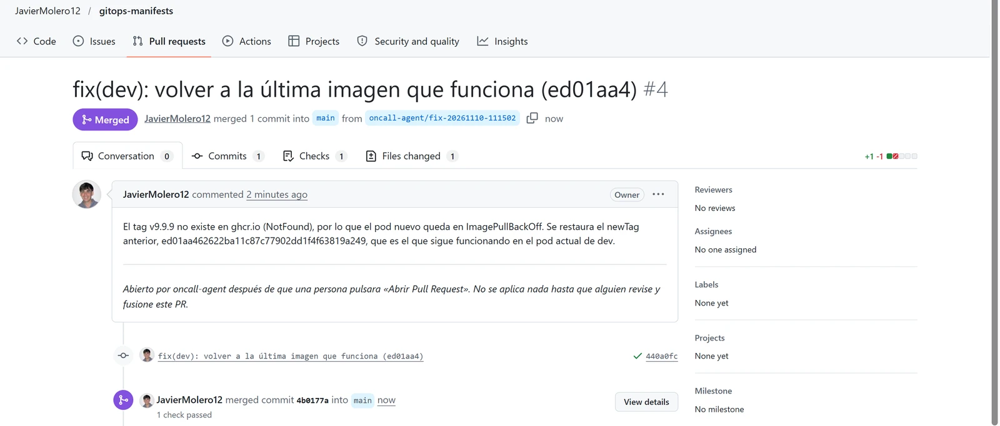
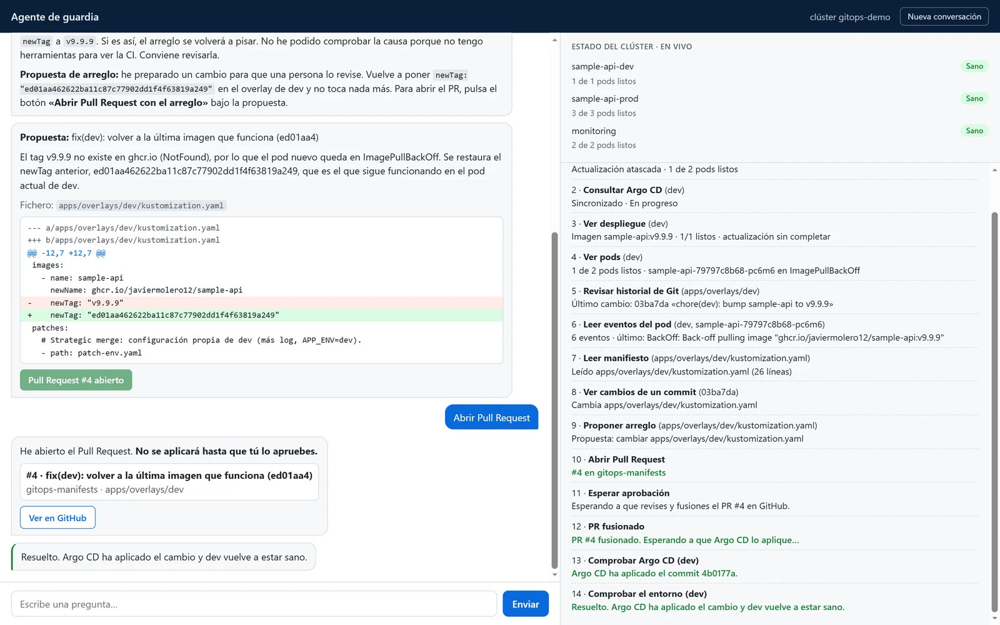
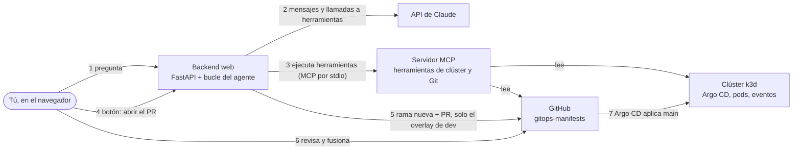

# oncall-agent

**Un agente de IA de guardia para Kubernetes: investiga qué falla con herramientas de solo lectura, te lo explica con pruebas y te propone el arreglo como Pull Request.**

> **In English:** an on-call AI agent for a GitOps Kubernetes cluster (k3d + Argo CD). It
> investigates with read-only tools, explains the cause with the evidence it found and proposes
> the fix as a pull request. A person opens it with a button and merges it on GitHub; then the
> agent follows Argo CD until the environment is healthy again. Python, the Claude API, MCP and
> FastAPI. The code and its comments are in English; this README and the agent's UI are in Spanish.



*Una conversación real con el clúster de verdad (10 de noviembre de 2026). A la derecha, el estado de cada entorno y los 9 pasos que dio el agente antes de responder.*

> **Estado del proyecto:** la fase 1 está terminada y ensayada tres veces contra el clúster real.
> Cubre el fallo 1: una etiqueta de imagen que no existe en dev. [Ver la hoja de ruta](#estado-del-proyecto).

---

## ¿Qué es este proyecto?

Cuando un despliegue se rompe en Kubernetes, la persona de guardia hace casi siempre lo mismo antes de arreglar nada:

- mira el estado de la aplicación en Argo CD;
- revisa los pods y sus eventos;
- busca en Git qué commit cambió qué.

Este agente hace esa investigación y te la cuenta con las pruebas. Le preguntas en un chat, por ejemplo *«¿Qué le pasa a sample-api en dev?»*, y el agente:

1. **Investiga** con herramientas de solo lectura: Argo CD, el Deployment, los pods, sus eventos y el historial de Git.
2. **Te explica la causa** en español, citando lo que ha visto: el evento del pod, el commit culpable y la línea que cambió.
3. **Te propone el arreglo** como un diff. Todavía no ha cambiado nada.
4. Si estás de acuerdo, **pulsas un botón** y el backend abre un Pull Request en el repositorio GitOps.
5. **Revisas y fusionas** el Pull Request en GitHub. Argo CD aplica el cambio y el chat te cuenta la recuperación hasta que el entorno vuelve a estar sano.

Tres ideas guían el diseño:

| Idea | En la práctica |
|---|---|
| **El modelo no puede romper nada** | Claude solo tiene herramientas de lectura. La única que escribe, la que abre el Pull Request, no se le ofrece nunca. |
| **Dos controles humanos** | Una persona pulsa el botón y una persona fusiona el Pull Request. |
| **Todo pasa por Git** | El arreglo es un commit revisado, como cualquier otro cambio en GitOps. Nadie toca el clúster con `kubectl`. |

El agente trabaja sobre la plataforma GitOps de mi portfolio, desplegada con Argo CD en un clúster k3d de mi portátil:

- [sample-api](https://github.com/JavierMolero12/sample-api): el código del servicio.
- [gitops-manifests](https://github.com/JavierMolero12/gitops-manifests): el estado deseado del clúster.

---

## Índice

- [La demo en imágenes](#la-demo-en-imágenes)
- [Resultados de los ensayos](#resultados-de-los-ensayos)
- [Guía rápida (si ya sabes programar)](#guía-rápida-si-ya-sabes-programar)
- [Guía paso a paso (si es tu primera vez)](#guía-paso-a-paso-si-es-tu-primera-vez)
- [¿Cómo funciona por dentro?](#cómo-funciona-por-dentro)
- [Seguridad: lo que puede hacer y lo que no](#seguridad-lo-que-puede-hacer-y-lo-que-no)
- [Qué hay en cada carpeta](#qué-hay-en-cada-carpeta)
- [Tests](#tests)
- [Problemas frecuentes](#problemas-frecuentes)
- [Glosario](#glosario)
- [Estado del proyecto](#estado-del-proyecto)
- [Documentación](#documentación)

---

## La demo en imágenes

**1. Rompo dev a propósito.** Lo hago con un commit que pide `sample-api:v9.9.9`, una imagen que no existe. El pod nuevo no puede descargarla, pero el viejo sigue sirviendo, así que dev no se cae: se queda a medio actualizar. El panel lo marca en amarillo:



**2. Le pregunto al agente.** Es la captura del principio. Ha mirado el entorno, Argo CD, el Deployment, los pods, los eventos, el historial de Git y el manifiesto. En la respuesta nombra `v9.9.9`, el commit que la introdujo (`03ba7da`) y la imagen buena, y propone volver a ella. También se dio cuenta de que ese fallo se repetía en el historial y avisó de que no puede ver la CI para comprobar la causa.

**3. Pulso «Abrir Pull Request con el arreglo».** El backend abre el Pull Request en gitops-manifests. Va en una rama nueva, con un solo commit, y solo toca el overlay de dev:



**4. Lo reviso y lo fusiono en GitHub.** Argo CD aplica el merge y el chat comprueba tres cosas: que el Pull Request está fusionado, que Argo CD ha sincronizado justo ese commit y que dev está sano.



---

## Resultados de los ensayos

Ensayé la demo tres veces el 10 de noviembre de 2026, contra el clúster real y con el modelo real (`claude-sonnet-5-5`):

| Ensayo | Romper → *Atascada* | Pregunta → propuesta | Merge → *Sano* | Qué pasó |
|---|---|---|---|---|
| 1 | 64 s | menos de 2 min | 18 s | Bien a la primera, con 7 herramientas ([PR #2](https://github.com/JavierMolero12/gitops-manifests/pull/2)) |
| 2 | 21 s | sin cronometrar | 24 s | Bien. Con dos commits `v9.9.9` en el historial, culpó al correcto ([PR #3](https://github.com/JavierMolero12/gitops-manifests/pull/3)) |
| 3 | 39 s | unos 60 s | 22 s | Bien, con 9 herramientas, y además avisó de que el fallo se repetía ([PR #4](https://github.com/JavierMolero12/gitops-manifests/pull/4)) |

En los tres ensayos el agente nombró `v9.9.9`, el commit que la introdujo y la etiqueta buena, y propuso volver a ella.

En el tercero aprendí algo: **el servidor guarda la conversación aunque recargues la página.** Mi primera pregunta de ese ensayo recibió *«la propuesta es la misma de antes»*, sin diff ni botón, porque el agente recordaba el ensayo anterior. Antes de cada demo hay que pulsar **Nueva conversación**.

El guion completo de la demo, con lo que digo en cada paso, está en [docs/demo-fase-1.md](docs/demo-fase-1.md).

---

## Guía rápida (si ya sabes programar)

**Necesitas:**
- Windows 10 u 11 (probado en Windows 10), con Python 3.13 o superior, Git, Docker Desktop, [k3d](https://k3d.io) y `kubectl`.
- El clúster `gitops-demo` con Argo CD y las apps de gitops-manifests. Si no lo tienes, el [paso 3](#paso-3--monta-el-clúster-solo-la-primera-vez) explica cómo montarlo.
- Una clave de la API de Claude y un token *fine-grained* de GitHub. El [paso 6](#paso-6--consigue-las-dos-claves) explica cómo crearlos.

```powershell
git clone https://github.com/JavierMolero12/oncall-agent.git
cd oncall-agent
py -3.13 -m venv .venv
.venv\Scripts\python -m pip install -e ".[dev]"
copy .env.example .env                                  # rellena ANTHROPIC_API_KEY y GITHUB_TOKEN
.venv\Scripts\python scripts\setup_argocd_polling.py    # Argo CD mira Git cada 30 s
.venv\Scripts\python -m oncall_agent.web                # http://127.0.0.1:8765
```

Para probarlo, en otra terminal:

```powershell
.venv\Scripts\python scripts\demo_faults.py break image    # rompe dev
# en el chat: «¿Qué le pasa a sample-api en dev?»
.venv\Scripts\python scripts\demo_faults.py restore        # lo deja como estaba
```

Tests: `.venv\Scripts\python -m pytest -q`. Son 131 y no necesitan el clúster, GitHub ni la API de Claude.

---

## Guía paso a paso (si es tu primera vez)

### Antes de empezar

Lo que vas a instalar, en una frase cada cosa:

| Qué | Para qué |
|---|---|
| **Docker Desktop** | Ejecuta contenedores. El clúster de Kubernetes vive dentro de Docker. |
| **k3d** | Crea un clúster de Kubernetes pequeño (k3s) dentro de Docker. |
| **kubectl** | La herramienta de línea de comandos para hablar con Kubernetes. Docker Desktop ya la trae. |
| **Python 3.13** | El lenguaje del agente. |
| **Git** | Para descargar el proyecto. |

Y dos cuentas:

- **Anthropic**: la clave de la API de Claude. Cada pregunta al agente cuesta unos céntimos.
- **GitHub**: el token con el que el agente lee el repositorio GitOps y abre los Pull Requests.

> Esta guía usa mis repositorios. Si quieres el tuyo propio, haz un fork de
> [gitops-manifests](https://github.com/JavierMolero12/gitops-manifests). Cambia `repoURL` en los
> ficheros de `argocd-apps/` y `GITOPS_REPO` en el `.env` del paso 6.

Todos los comandos son para **PowerShell**.

### Paso 1 — Arranca Docker Desktop

Ábrelo desde el menú Inicio y espera a que diga *Engine running*. Sin Docker no hay clúster.

### Paso 2 — Descarga el proyecto

```powershell
git clone https://github.com/JavierMolero12/oncall-agent.git
cd oncall-agent
```

### Paso 3 — Monta el clúster (solo la primera vez)

Si ya tienes el clúster `gitops-demo`, salta al paso 4. Si no, estos comandos montan el mismo que uso yo:

```powershell
# 1. Un clúster con un nodo de trabajo. El puerto 8080 del PC lleva a Traefik, el Ingress de k3s.
k3d cluster create gitops-demo --agents 1 --api-port 6550 -p "8080:80@loadbalancer"

# 2. Argo CD 3.5.5, la versión con la que lo he probado.
kubectl create namespace argocd
kubectl apply -n argocd --server-side --force-conflicts -f https://raw.githubusercontent.com/argoproj/argo-cd/v3.5.5/manifests/install.yaml

# 3. Su web, en http://argocd.localhost:8080. Traefik le pasa el tráfico por HTTP, sin TLS.
kubectl -n argocd patch configmap argocd-cmd-params-cm --type merge --patch-file docs/cluster/argocd-insecure.yaml
kubectl -n argocd rollout restart deployment argocd-server
kubectl apply -f docs/cluster/argocd-ingress.yaml

# 4. La Application raíz: a partir de aquí, todo llega desde Git (patrón App-of-Apps).
kubectl apply -f https://raw.githubusercontent.com/JavierMolero12/gitops-manifests/main/argocd-apps/root-application.yaml
```

> **¿Por qué `--api-port 6550`?** Si no lo pones, k3d elige un puerto al azar para la API del
> clúster. Windows reserva rangos de puertos al arrancar, y si cae dentro de uno, el clúster deja
> de arrancar. Me pasó a mí: está en [Problemas frecuentes](#problemas-frecuentes).

Dev y la monitorización se despliegan solas. **Prod no**, a propósito: en prod, una persona decide cuándo se aplica un cambio. Abre la web de Argo CD (paso 4), entra en `sample-api-prod` y pulsa **SYNC**.

### Paso 4 — Comprueba que Argo CD está en verde

```powershell
kubectl --context k3d-gitops-demo -n argocd get applications
```

Deberías ver cuatro aplicaciones en `Synced` y `Healthy`: `root`, `sample-api-dev`, `sample-api-prod` y `monitoring`.

Para verlo en la web, abre <http://argocd.localhost:8080>. El usuario es `admin` y la contraseña la saca este comando:

```powershell
kubectl --context k3d-gitops-demo -n argocd get secret argocd-initial-admin-secret -o jsonpath="{.data.password}" | ForEach-Object { [Text.Encoding]::UTF8.GetString([Convert]::FromBase64String($_)) }
```

### Paso 5 — Crea el entorno de Python

Un entorno virtual es una carpeta (`.venv`) con un Python y unas librerías solo para este proyecto. Así no se mezclan con las de otros.

```powershell
py -3.13 -m venv .venv
.venv\Scripts\python -m pip install -e ".[dev]"
.venv\Scripts\python -m pytest -q
```

El último comando pasa los tests. Debe terminar en `131 passed`. Los comandos llaman directamente a `.venv\Scripts\python`, así que no hace falta activar el entorno.

### Paso 6 — Consigue las dos claves

1. **Clave de Claude.** En la [consola de Anthropic](https://console.anthropic.com/): *API keys* → *Create key*. La cuenta necesita saldo.
2. **Token de GitHub.** En GitHub: *Settings* → *Developer settings* → *Personal access tokens* → *Fine-grained tokens* → *Generate new token*.
   - *Repository access*: *Only select repositories* → `gitops-manifests`.
   - *Permissions*: *Contents* y *Pull requests*, las dos en *Read and write*. *Metadata: read* se añade solo.
   - Ponle una caducidad corta.
3. Crea tu `.env` a partir del ejemplo y pega las dos claves:

   ```powershell
   copy .env.example .env
   notepad .env
   ```

`.env` está en `.gitignore`: las claves nunca se suben a Git. En `.env.example` están también las opciones, como el modelo (`ONCALL_MODEL`, por defecto `claude-sonnet-5-5`) o el límite de pasos por pregunta (`ONCALL_MAX_STEPS`, 15).

### Paso 7 — Haz que Argo CD mire Git cada 30 segundos

Por defecto, Argo CD consulta Git cada pocos minutos. En la nube, un webhook de GitHub le avisaría de cada commit al momento, pero los webhooks no llegan a un portátil. Sin este paso, la demo esperaría minutos dos veces: al romper y al fusionar.

```powershell
.venv\Scripts\python scripts\setup_argocd_polling.py
```

Hay que repetirlo cada vez que se crea el clúster de nuevo. En un clúster real, consultar Git tan a menudo sale caro y lo correcto es el webhook.

### Paso 8 — Arranca el agente

```powershell
.venv\Scripts\python -m oncall_agent.web
```

Deja esa ventana abierta y entra en <http://127.0.0.1:8765>. A la izquierda está el chat. A la derecha, el estado de cada entorno en vivo y, debajo, los pasos del agente. Los tres entornos deberían salir en verde, *Sano*.

### Paso 9 — Rompe dev a propósito

En **otra** ventana de PowerShell, dentro de la carpeta del proyecto:

```powershell
.venv\Scripts\python scripts\demo_faults.py break image
```

El script hace lo que haría un mal commit: sube a `main` de gitops-manifests un `newTag: "v9.9.9"`, una etiqueta que no existe. En menos de un minuto, el panel pone dev en amarillo: **Actualización atascada**.

> Lo rompo con un commit y no con `kubectl` porque en GitOps la verdad está en Git. Si lo
> cambiara a mano, Argo CD lo desharía.

### Paso 10 — Pregunta al agente

Si ya habías preguntado algo antes, pulsa **Nueva conversación**. Después escribe:

> ¿Qué le pasa a sample-api en dev?

Verás cada herramienta aparecer en directo en *Pasos del agente*. En un minuto, más o menos, llega la respuesta con las pruebas y, debajo, la propuesta: el diff y el botón **Abrir Pull Request con el arreglo**.

### Paso 11 — Abre el Pull Request y fusiónalo

1. Pulsa el botón. Es el primer control humano: el chat contesta *«He abierto el Pull Request. No se aplicará hasta que tú lo apruebes.»*
2. Abre el enlace *Ver en GitHub*, revisa el diff y pulsa **Merge pull request**. Es el segundo control humano.

### Paso 12 — Mira cómo se recupera

Sin tocar nada más, el chat comprueba tres cosas, una detrás de otra:

- que el Pull Request está fusionado;
- que Argo CD ha aplicado justo ese commit;
- que dev vuelve a estar sano.

Al final pone **Resuelto**, en verde, y el panel vuelve a *Sano*. En mis ensayos, del merge a *Sano* pasaron entre 18 y 24 segundos.

### Dejarlo todo como estaba

Si rompiste dev pero no llegaste a fusionar el arreglo, vuelve a dejar la imagen buena con otro commit:

```powershell
.venv\Scripts\python scripts\demo_faults.py restore
```

> **No hagas push a sample-api durante la demo.** Su CI reescribe `newTag` en el overlay de dev
> con un commit automático, y pisaría tanto la rotura como el arreglo.

### Volver otro día

1. Arranca Docker Desktop.
2. Arranca el clúster: `k3d cluster start gitops-demo`.
3. Comprueba Argo CD (paso 4) y arranca el agente (paso 8).

---

## ¿Cómo funciona por dentro?



1. **El bucle del agente** está escrito a mano con el SDK oficial de Anthropic:
   - Claude pide una herramienta.
   - El backend la ejecuta y le devuelve el resultado.
   - Se repite hasta que Claude responde.

   Un límite de 15 pasos acota el coste de cada pregunta.
2. **Las herramientas viven en un servidor MCP**, hecho con el SDK oficial de Python. El backend lo arranca como subproceso y le habla por stdio. MCP es un estándar: el mismo servidor funciona con cualquier cliente MCP, también con Claude Code.
3. **Cada paso aparece en directo** en el panel *Pasos del agente*, con Server-Sent Events (SSE).
4. **Proponer no es escribir.** Cuando Claude encuentra la causa, llama a `propose_fix`. Esa herramienta comprueba la propuesta y devuelve el diff, pero no cambia nada. El backend guarda la propuesta.
5. **El Pull Request lo abre el backend, no el modelo.** Lo hace al pulsar el botón y con la propuesta guardada: una rama `oncall-agent/fix-<fecha>`, un commit y un Pull Request.
6. **La recuperación se vigila sola.** Tras el merge, el chat espera a que Argo CD sincronice *justo el commit del merge*. No vale uno cualquiera. Después espera a que el entorno esté sano.

### Las herramientas

| Herramienta | En el panel | Qué hace |
|---|---|---|
| `get_environment_status` | Ver estado del entorno | La salud de un entorno, la misma que enseña el panel |
| `get_argocd_app` | Consultar Argo CD | La `Application` de Argo CD: sincronización, salud y revisión |
| `get_deployment` | Ver despliegue | Imagen, réplicas y progreso de la actualización |
| `list_pods` | Ver pods | Los pods con su estado y su motivo, por ejemplo `ImagePullBackOff` |
| `get_pod_events` | Leer eventos del pod | Los eventos de un pod, como *Failed to pull image* |
| `list_recent_commits` | Revisar historial de Git | Los últimos commits que tocaron una ruta de gitops-manifests |
| `get_commit_diff` | Ver cambios de un commit | Qué cambió un commit |
| `read_manifest` | Leer manifiesto | Un fichero de gitops-manifests |
| `propose_fix` | Proponer arreglo | Comprueba el fichero propuesto y devuelve el diff. No escribe nada |
| `get_pull_request` | Consultar Pull Request | El estado de un Pull Request |
| `open_pull_request` | Abrir Pull Request | **La única que escribe.** Nunca se le ofrece al modelo |

---

## Seguridad: lo que puede hacer y lo que no

- **En el clúster, solo lee.** Las herramientas solo consultan y listan a través de la API de Kubernetes; ninguna crea, cambia ni borra nada. Argo CD se lee a través de sus recursos `Application`, sin iniciar sesión en Argo CD, y el agente nunca fuerza una sincronización.
- **El modelo no tiene herramientas de escritura.** El backend solo le ofrece a Claude las herramientas de lectura, y el bucle se niega a ejecutar cualquier nombre que no le haya ofrecido.
- **Hay una sola escritura, y está detrás de una persona.** `open_pull_request` se ejecuta al pulsar el botón y con la propuesta guardada, no con texto nuevo del modelo. Tiene estas restricciones:
  - solo acepta ficheros de `apps/overlays/dev/`;
  - se niega si el fichero ha cambiado en `main` desde la propuesta;
  - trabaja en una rama nueva.

  No hay ninguna herramienta para fusionar, aprobar ni hacer push a `main`.
- **Dos controles humanos:** pulsar el botón y fusionar el Pull Request.
- **Los secretos** están en un `.env` local que Git ignora. `.env.example` solo enseña los nombres de las variables.
- **La página no tiene login**, así que el servidor solo escucha en `127.0.0.1` y solo responde a peticiones dirigidas a `127.0.0.1` o `localhost`. Esta segunda comprobación frena el *DNS rebinding*: una web de otro dominio que resuelva a `127.0.0.1` no puede usar la API.

### Limitaciones conocidas (v1)

- **El token de GitHub puede hacer más que el código.** Es un token *fine-grained* limitado a gitops-manifests, con *Contents* y *Pull requests* en lectura y escritura. El problema:
  - actúa como su dueño, que administra el repositorio, así que el token podría hacer push a `main` o fusionar;
  - los tokens fine-grained no se pueden limitar a ciertas ramas;
  - hoy lo único que lo impide es que el código del agente no tiene esas funciones.

  En producción, el agente tendría su propia identidad: una GitHub App instalada solo en el repositorio GitOps. Además, `main` estaría protegida con un *ruleset* que exija Pull Request y una revisión aprobada. Así, ni un agente comprometido podría hacer otra cosa que abrir Pull Requests.
- **El contexto de kubeconfig es administrador del clúster.** El código solo lee, pero las credenciales permiten más. En la fase 3 lo cambio por un ServiceAccount con un ClusterRole de solo lectura, desplegados por GitOps.

### Usar el servidor MCP desde Claude Code (opcional)

El servidor MCP también funciona por su cuenta. Ejecútalo desde la carpeta del proyecto, porque lee `.env` de la carpeta donde arranca:

```powershell
claude mcp add oncall-agent -- .venv\Scripts\python -m oncall_agent.mcp_server
```

En ese caso, el modelo **sí** ve `open_pull_request`, y la única barrera es la confirmación que pida el propio cliente. Si no pones `GITHUB_TOKEN` en `.env`, esa herramienta se niega a ejecutarse.

---

## Qué hay en cada carpeta

```
src/oncall_agent/
  config.py         la configuración, leída de .env
  kube.py           los clientes de Kubernetes
  status.py         la salud de cada entorno para el panel
  tools/            las herramientas: cluster.py (Kubernetes, Argo CD) y gitops.py (Git)
  github.py         un cliente pequeño para la API REST de GitHub
  mcp_server.py     el servidor MCP con las herramientas
  toolbox.py        el cliente MCP que usa el backend
  agent.py          el bucle del agente y su system prompt
  recovery.py       sigue un arreglo fusionado: Pull Request, Argo CD, entorno sano
  web/              la app de FastAPI y la página (HTML, CSS y JavaScript, sin compilar nada)
scripts/            demo_faults.py (romper y restaurar dev), setup_argocd_polling.py
tests/              131 tests con dobles de GitHub, del clúster y del modelo
docs/
  images/           las capturas de este README
  cluster/          los dos ficheros del paso 3
  demo-fase-1.md    el guion de la demo y el registro de ensayos
  guia/guia.html    la guía de estudio que fui escribiendo mientras lo construía
  superpowers/      el diseño, la maqueta de la interfaz y el plan de la fase 1
```

---

## Tests

```powershell
.venv\Scripts\python -m pytest -q
.venv\Scripts\python -m ruff check .
```

Los 131 tests no necesitan el clúster, GitHub ni la API de Claude:

| Lo de fuera | Su doble en los tests |
|---|---|
| GitHub | Un doble en memoria detrás de `httpx.MockTransport` |
| El modelo | Un doble con guion, que pide las herramientas en un orden fijo |
| El clúster | Clientes falsos con los objetos que devolvería Kubernetes |

Así se prueba el bucle completo: las herramientas, la propuesta, el botón y la recuperación.

---

## Problemas frecuentes

| Qué pasa | Qué hacer |
|---|---|
| El panel dice «No puedo conectar con el clúster» | Docker o el clúster están parados. Arranca Docker Desktop, ejecuta `k3d cluster start gitops-demo` y espera a que vuelva el panel. |
| `k3d cluster start` falla con «ports are not available … permisos de acceso» | Windows ha reservado el puerto de la API del clúster. Se ve con `netsh interface ipv4 show excludedportrange protocol=tcp`. En PowerShell **como administrador**: `net stop winnat`, `k3d cluster start gitops-demo` y `net start winnat`. Para que no vuelva a pasar, crea el clúster con `--api-port 6550` ([paso 3](#paso-3--monta-el-clúster-solo-la-primera-vez)). |
| La web de Argo CD no carga | Usa <http://argocd.localhost:8080>, con `http` y no `https`. Si prefieres un `port-forward`, que sea al puerto 80 del servicio: `kubectl -n argocd port-forward svc/argocd-server 8081:80`. Por el 443 se corta, porque Argo CD va sin TLS. |
| El agente responde «la propuesta es la misma de antes» y no sale el botón | Se acuerda de una conversación anterior. Pulsa **Nueva conversación** y pregunta otra vez. |
| dev no pasa a *Actualización atascada* | Argo CD todavía no ha mirado Git. Comprueba que el paso 7 está hecho (`timeout.reconciliation` en `30s`) y espera un minuto. |
| Error de GitHub al abrir el Pull Request | Revisa `GITHUB_TOKEN`: que no haya caducado y que tenga *Contents* y *Pull requests* en *Read and write* sobre gitops-manifests. |
| La rotura o el arreglo desaparecen solos | Alguien ha hecho push a sample-api y su CI ha reescrito `newTag`. Espera a que termine y repite. |

---

## Glosario

- **GitOps:** forma de operar en la que el estado deseado del sistema vive en Git. Para cambiar algo, haces un commit; un programa se encarga de que el clúster lo refleje.
- **Argo CD:** ese programa. Compara lo que dice Git con lo que hay en el clúster y lo reconcilia.
- **Application y App-of-Apps:** una `Application` le dice a Argo CD qué carpeta de Git desplegar y dónde. En el patrón App-of-Apps, una Application raíz gestiona a las demás.
- **Kustomize y overlay:** Kustomize genera los manifiestos de Kubernetes a partir de una base común. Un overlay (`dev`, `prod`) aplica encima los cambios de cada entorno, como la etiqueta de la imagen.
- **k3d:** crea clústeres de Kubernetes ligeros (k3s) dentro de Docker.
- **Pod, Deployment y ReplicaSet:** un pod ejecuta contenedores. Un Deployment declara qué imagen y cuántas réplicas quieres, y lo cumple a través de ReplicaSets. En una actualización, el ReplicaSet viejo sigue sirviendo hasta que el nuevo está listo.
- **ImagePullBackOff:** el pod no consigue descargar su imagen (por ejemplo, porque no existe) y Kubernetes espera cada vez más entre reintentos.
- **MCP (Model Context Protocol):** un estándar para dar herramientas a un modelo de IA. Un servidor MCP expone herramientas, y cualquier cliente MCP puede usarlas.
- **Tool use:** el modelo no ejecuta nada. Pide una herramienta con unos argumentos, el programa la ejecuta y le devuelve el resultado.
- **SSE (Server-Sent Events):** una conexión HTTP por la que el servidor va enviando eventos al navegador. Así aparecen los pasos en directo.
- **Pull Request:** una propuesta de cambio en GitHub que alguien revisa antes de fusionarla en `main`.
- **Token fine-grained:** un token de GitHub limitado a unos repositorios y unos permisos concretos.

---

## Estado del proyecto

| Fase | Qué incluye | Estado |
|---|---|---|
| **1** | Fallo 1, una imagen que no existe en dev: las herramientas de lectura, el servidor MCP, el bucle del agente, el chat, la propuesta con botón, la vigilancia de la recuperación y los scripts de la demo. 131 tests y tres ensayos contra el clúster real. | ✅ Terminada |
| **2** | Dos fallos más, con las herramientas que necesitan (logs de los contenedores, estado de los contenedores, recursos y métricas) y sus scripts para romper y restaurar. | Pendiente |
| **3** | Mínimo privilegio: un ServiceAccount y un ClusterRole de solo lectura para el agente, desplegados por GitOps. También una grabación de la demo para este README. | Pendiente |

---

## Documentación

- [El diseño](docs/superpowers/specs/2026-11-04-oncall-agent-design.md): objetivos, decisiones y lo que queda fuera.
- [El plan de la fase 1](docs/superpowers/plans/2026-11-04-oncall-agent-fase-1.md): las 13 tareas, cada una con sus tests.
- [El guion de la demo](docs/demo-fase-1.md): qué hago, qué se ve y qué digo en cada paso, más el registro de ensayos.
- [La guía de estudio](docs/guia/guia.html): un apartado por pieza, para entender y explicar el proyecto. Es un HTML: descárgalo y ábrelo en el navegador.
